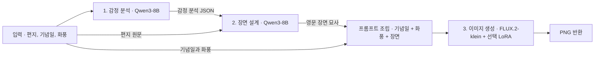

# Momento · 편지를 한 장의 일러스트로

**편지의 감정과 상황을 읽고, 기념일과 화풍을 반영한 이미지를 생성하는 팀 프로젝트입니다.** Qwen3-8B가 편지를 분석하고 장면을 묘사한 뒤, FLUX.2-klein-base-4B가 그 장면을 1024×1024 PNG로 그립니다. Python CLI와 FastAPI로 같은 파이프라인을 실행할 수 있습니다.

| 생일 | 크리스마스 |
| --- | --- |
|  |  |

*팀 LoRA를 사용한 기존 실험 결과입니다. 아래의 설명용 편지와 기본 모델 실행 예시는 별개입니다.*

## 1. 파이프라인 구조



| 단계 | 입력 | 출력 | 구현 |
| --- | --- | --- | --- |
| 감정 분석 | 편지 원문 | 주요·보조 감정, 관계와 분위기 등을 담은 JSON 문자열 | [emotion.py](emotion.py) |
| 장면 설계 | 편지 원문과 감정 분석 JSON | `visual_prompt`, `scene_summary`, 구도 보정 여부 | [prompt.py](prompt.py) |
| 이미지 생성 | 최종 프롬프트, 화풍, negative prompt, 시드 | 1024×1024 이미지 한 장 | [flux.py](flux.py) |

[pipeline.py](pipeline.py)의 `MomentoPipeline.generate()`가 세 단계를 호출합니다. CLI와 API 모두 이 메서드를 사용하고, 감정 분석과 장면 프롬프트는 메모리로 전달합니다.

## 2. 단계별 동작

### 1단계 · 편지에서 감정과 관계 읽기

[llm.py](llm.py)의 `QwenLLM`이 Transformers로 Qwen3-8B를 불러옵니다. [emotion.py](emotion.py)는 편지 원문을 사용자 메시지로 넣고, 주요 감정과 보조 감정, 감정의 근거, 관계, 분위기 등을 JSON으로 작성하도록 요청합니다.

응답은 JSON으로 파싱 가능한지 검사합니다. 파싱에 실패하면 흔한 쉼표 누락을 보정해 보고, 그래도 실패하면 다시 생성합니다. 최대 3회 안에 유효한 결과가 없으면 오류를 반환합니다. 검사를 통과한 JSON 문자열을 다음 단계로 전달합니다.

### 2단계 · 감정을 그릴 수 있는 장면으로 바꾸기

[prompt.py](prompt.py)는 **편지 원문과 감정 분석을 함께** Qwen에 넣습니다. 원문은 등장인물과 상황을 판단하는 근거로, 감정 분석은 표정과 분위기를 설계하는 참고로 사용합니다. 이를 바탕으로 영문 장면 묘사 `visual_prompt`와 상황 요약 `scene_summary`를 생성합니다.

이미지에 깨진 문자가 그려지는 경우를 줄이기 위해 프롬프트에서 인용 문구와 한글을 제거합니다. 글자가 들어가기 쉬운 표면이 감지되면 최대 5회 생성 루프 안에서 장면을 다시 쓰도록 요청합니다. 유효한 묘사는 얻었지만 해당 요소가 남으면, 구도 보정 문구를 붙이는 대체 경로를 사용합니다.

최종 FLUX 입력은 **기념일 문구 → 화풍 트리거(해당 시) → 장면 묘사 → 구도 보정(해당 시)** 순서로 조립합니다. `생일`, `크리스마스`, `기념일`은 설정에 등록된 영어 문구로 변환되고, 목록 밖의 기념일은 입력 문구를 그대로 사용합니다.

### 3단계 · FLUX로 이미지 생성

[flux.py](flux.py)는 Diffusers의 `Flux2KleinPipeline`을 사용합니다. 기본 출력은 **1024×1024**, 추론은 **28스텝**입니다. 팀 LoRA를 사용할 때는 요청한 어댑터를 선택하고 프리셋의 guidance를 적용합니다. 글자·워터마크 등을 피하도록 지정한 negative prompt는 임베딩으로 변환해 전달하며, 같은 임베딩은 재사용합니다.

요청 ID를 전달하면 SHA-256으로부터 FLUX 시드를 계산합니다. 같은 ID는 같은 **FLUX 시드**를 만들지만, Qwen은 샘플링으로 장면을 생성하므로 최종 이미지가 매번 같을 수는 없습니다.

## 3. GPU 한 장에서의 실행 흐름

서비스가 시작될 때 FLUX를 초기화하고, 디스크에 있는 화풍 LoRA를 불러옵니다. FLUX는 **CPU 오프로딩**을 사용해 필요한 구성요소를 GPU로 옮깁니다. Qwen은 요청이 들어오면 GPU에 로드하고, 감정 분석과 장면 작성에 같은 모델을 사용합니다. 두 단계가 끝나면 Qwen을 해제한 뒤 FLUX가 이미지를 생성합니다.

요청은 파이프라인의 잠금으로 한 번에 하나씩 처리합니다. 이 구조는 팀이 사용한 **RTX A5000 24GB** 환경을 기준으로 작성됐습니다. 실행 시간과 메모리 사용량은 모델 캐시, 호스트 RAM, GPU, 화풍 설정에 따라 달라집니다.

## 4. 단계별 예시

아래는 입력이 시각 요소로 바뀌는 방식을 설명하기 위해 새로 작성한 예시입니다.

- **편지** · “생일 축하해! 비가 오던 날 우산을 나눠 쓰고 걷던 일이 아직도 생각나. 이번엔 창가에 앉아 같이 케이크 먹자.”
- **감정 요약** · 함께한 기억을 떠올리는 따뜻함과 다시 만날 날에 대한 기대.
- **장면 묘사** · `Two friends sharing a birthday cake beside a rain-speckled window, soft afternoon light and relaxed smiles.`
- **FLUX 입력 예시** · `a birthday celebration, Two friends sharing a birthday cake beside a rain-speckled window, soft afternoon light and relaxed smiles.`
- **출력** · CLI에서 지정한 경로의 PNG 또는 API의 `image/png` 응답.

## 5. 실행 방법

Python 3.12와 **CUDA 및 BF16을 지원하는 NVIDIA GPU**, 모델을 저장할 디스크 공간이 필요합니다. 첫 실행은 Hugging Face에서 기반 모델을 받습니다. 이미 내려받은 모델은 `HF_HOME`으로 지정한 캐시에서 재사용할 수 있습니다. [Qwen3-8B 모델 카드](https://huggingface.co/Qwen/Qwen3-8B) · [FLUX.2-klein-base-4B 모델 카드](https://huggingface.co/black-forest-labs/FLUX.2-klein-base-4B)

CUDA에서 동작하는 PyTorch 환경을 준비하고, 저장소 루트에서 실행합니다.

```bash
python -m pip install -r requirements.txt
python run.py --letter "생일 축하해! 창가에서 같이 케이크 먹자." --event birthday --style base --out output.png
```

- `--letter_file letter.txt`로 UTF-8 파일을 입력할 수 있습니다. `--letter`와 둘 중 하나를 사용합니다.
- `--show-prompt`를 주면 콘솔의 결과 JSON에 FLUX 프롬프트도 출력됩니다.
- `--request_id demo-01`을 주면 해당 ID를 기반으로 FLUX 시드를 계산합니다.

### 팀 화풍 LoRA 연결

공개본의 기본 화풍은 **`base`**이며 별도 LoRA 파일 없이 기반 모델을 사용합니다. 팀 화풍을 사용하려면 보유한 가중치를 `loras/<화풍>/pytorch_lora_weights.safetensors`에 두고 해당 화풍을 지정합니다. 서버는 시작 시점에 찾은 화풍을 사용합니다.

| 화풍 ID | 트리거 | Guidance |
| --- | --- | ---: |
| `base` | — | 3.5 |
| `pstl` | `mmt_pstl` | 1.5 |
| `water` | `mmt_wtrc` | 2.5 |
| `cozy` | `mmt_cozy` | 1.5 |
| `vintage` | `mmt_vntg` | 2.5 |
| `anime` | `mmt_anime` | 2.5 |
| `josen` | `mmt_josn` | 3.5 |

예를 들어 `loras/pstl/pytorch_lora_weights.safetensors`를 배치하면 `--style pstl`을 사용할 수 있습니다. `base` 모드와 팀 LoRA로 그린 예시의 화풍은 달라질 수 있습니다.

### HTTP API

```bash
python -m uvicorn server:app --host 127.0.0.1 --port 8000
```

| 요청 | 결과 |
| --- | --- |
| `GET /styles` | 현재 사용 가능한 화풍과 기념일 매핑 |
| `POST /generate` | `letter`, `event`, 선택 항목인 `style`과 `request_id`를 받아 PNG 반환 |

```bash
curl -X POST http://127.0.0.1:8000/generate \
  -H 'Content-Type: application/json' \
  -d '{"letter":"Happy birthday! Let us share a cake by the window.","event":"birthday","style":"base","request_id":"demo-01"}' \
  -o output.png
```

응답에는 `X-Request-Id`와 `X-Seed` 헤더가 포함됩니다. 지원하지 않는 화풍이나 빈 편지는 HTTP 400을 반환합니다. 서버의 기본 결과 로그에는 요청 ID, 화풍과 단계별 소요 시간이 남습니다.

## 6. 저장소 구성

| 파일 | 역할 |
| --- | --- |
| [config.py](config.py) | 모델 ID, 출력 크기, 기념일과 화풍 프리셋 |
| [llm.py](llm.py) | Qwen 로딩, 채팅 템플릿과 텍스트 생성, GPU 메모리 해제 |
| [emotion.py](emotion.py) · [prompt.py](prompt.py) | 편지 분석, JSON 재시도, 장면 작성과 최종 프롬프트 조립 |
| [flux.py](flux.py) · [pipeline.py](pipeline.py) | 이미지 생성과 세 단계 연결, 요청 잠금과 시드 계산 |
| [run.py](run.py) · [server.py](server.py) | CLI와 FastAPI 진입점 |
| [requirements.txt](requirements.txt) · [assets/](assets/) | Python 의존성 및 기존 실험 이미지 |

공개용 패키지에는 기존 편지 원문, 중간 JSON, 서버 로그, 팀 LoRA 가중치와 내부 NAS 실행 스크립트를 포함하지 않았습니다. 공개본은 코드 문법과 모의 모델을 사용한 단계 연결을 검증했습니다. 실제 GPU 생성은 기존 실험 이미지를 참고할 수 있습니다.
